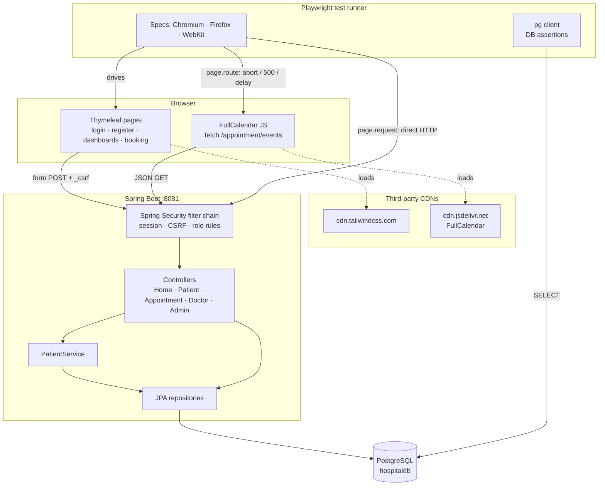

# CSE731 Software Testing: Final Project Report

**End-to-end functional testing of a Hospital Management System**

| Project | Details |
|---|---|
| Team | Dharani Prasad S (MT2025043), Abhishek Prasanna (MT2025007) |
| Repository | https://github.com/dharani070707/Software-Project |
| Test framework | Playwright 1.65.1 (TypeScript), Chromium / Firefox / WebKit |
| Test run | 27 Nov 2026, 62 test cases × 3 browsers = 186 executions |

### Division of work

The work is split equally into two parts. Each member designed, ran and triaged the tests in their part, wrote the bug reports for the bugs those tests found, and wrote their sections of this report.

| | **Part A: Dharani Prasad S (MT2025043)** | **Part B: Abhishek Prasanna (MT2025007)** |
|---|---|---|
| Focus | Authentication, registration validation, network resilience, anonymous access | Data workflows, admin features, booking validation, session security |
| Setup and code | Application under test, Playwright configuration, `helper/auth.ts`, `summary.mjs`, README | Local test environment, `helper/app.ts` (DB assertions, CSRF, test data, booking and logout helpers) |
| Test files | `tests/auth/*` (14)<br>`negative/bypass-registration.spec.ts` (4)<br>`negative/network.spec.ts` (6)<br>`negative/access.spec.ts` (7) | `tests/appointments/*` (7)<br>`tests/workflow/*` (2) + `tests/admin/*` (5)<br>`negative/bypass-booking.spec.ts` (6)<br>`negative/session.spec.ts` (11) |
| Client-side technique | Bypass testing (registration form) | Bypass testing (booking form) and session-data-based testing |
| Test cases | **31** | **31** |
| Executions (× 3 browsers) | 93: 60 passed, 33 failed | 93: 60 passed, 33 failed |
| Bugs reported | **10** (BUG-01 to BUG-10) | **10** (BUG-11 to BUG-20) |
| Report sections | 1.1 Architecture, 1.3 Tools, 1.4 Browser compatibility, 2.1-A and 2.2-A, 3 Repository | 1.2 Testing problems and techniques, 2.1-B and 2.2-B, 2.3 Execution summary |

---

# 1. Documentation

## 1.1 Application architecture

The application under test is a Hospital Management System with three roles. **Patients** register, log in and book appointments. **Doctors** see their appointments. **Admins** manage users (change role, delete) and appointments (complete, delete).

| Layer | Technology |
|---|---|
| Web UI | Thymeleaf server-rendered HTML, Tailwind CSS (CDN), FullCalendar 6 (CDN) |
| Application server | Java 21, Spring Boot 3, Spring MVC, Spring Security (form login, sessions, CSRF) |
| Data access | Spring Data JPA / Hibernate |
| Database | PostgreSQL 16 (`users`, `patients`, `appointments`) |



The tests interact with the system in four ways:
1. **Through the browser**, as a user would.
2. **Through direct HTTP requests** that skip the browser (bypass testing).
3. **By intercepting the network** (failure simulation).
4. **By reading PostgreSQL directly**, to prove each action did, or did not, change the database.

## 1.2 Testing problems considered

| # | Problem | Why it matters here | Tests |
|---|---|---|---|
| P1 | Registration and authentication | The entry point of every workflow, with three roles | TC-AUTH |
| P2 | Adding records and checking the database | The requirement is a real DB update, not just a UI change | TC-APPT, TC-FLOW |
| P3 | Editing and deleting existing records | Admin role changes and deletes affect other users' access | TC-ADM, TC-FLOW |
| P4 | Critical multi-role workflow | One record created by a patient must reach the doctor and the admin | TC-FLOW |
| P5 | Form validation done only in the browser | `required`, `min`, `minlength`, `type=email` and `<select>` options can all be bypassed | TC-BYP, TC-AUTH-07 |
| P6 | Unauthorized access | Role rules, session lifetime, CSRF, data returned to the wrong user | TC-UNAUTH |
| P7 | Network failures | The calendar depends on an AJAX call and two CDNs | TC-NET |
| P8 | Browser compatibility | Behaviour must be the same on all three browser engines | all tests, 3 Playwright projects |

### Client-side testing techniques

**Bypass testing** (Offutt et al.) generates the form-validation negative cases. The browser enforces input rules, but the server may not, and an attacker can skip the browser entirely. Each client-side rule was bypassed at one of three levels:

| Level | What is changed | Example |
|---|---|---|
| Value | Send a value the HTML would block | past date (`min`), empty `required` field, invalid email, too-short password, time `25:99`, a name longer than the DB column |
| Parameter | Tamper with a value the UI doesn't let the user choose | rewrite a `<select>` option so `doctorId` = the admin's id; a non-existent id |
| Control flow | Skip the form and POST straight to the server | `page.request.post('/appointment/book', …)` with a field missing |

In Playwright, `form.noValidate = true` and `removeAttribute('min')` switch off the HTML5 checks, `page.evaluate()` rewrites DOM values, and `page.request.post()` sends raw requests with a valid CSRF token. **The verdict always comes from the database:** an input counts as rejected only if no row was written.

**Session-data-based testing** generates the unauthorized-access cases. Spring stores the login in a `JSESSIONID` cookie and protects forms with a `_csrf` token. The tests capture, replay, forge or remove this session data: no session, the wrong role, replaying an admin request with a real CSRF token, a cookie reused after logout (`storageState`), a tampered session id, session fixation, and a request with the CSRF token missing.

**Network-failure simulation** uses `page.route()` to abort a request, answer it with HTTP 500, or delay it by 5 s, and `context.setOffline(true)` to drop the connection.

## 1.3 Choice of tools

| Need | Choice | Reason |
|---|---|---|
| Browser automation | **Playwright** | One API for Chromium, Firefox and WebKit, so cross-browser runs are built in. Auto-waiting reduces flaky tests. |
| Network failures | Playwright `page.route`, `setOffline` | Built in, so no proxy is needed. It can abort, fake or delay any request, including CDN files. |
| Session manipulation | Playwright `storageState`, `context.cookies()` / `addCookies()` | Save, replay and edit cookies per browser context. Separate contexts give separate users in one test. |
| Bypass / API requests | Playwright `page.request` | Shares the browser's cookies, so raw HTTP requests are sent as the logged-in user. Postman was therefore not needed. |
| Database assertions | `pg` (node-postgres) | Confirms that DB changes really happened, independent of what the UI shows. |
| Reporting | Playwright HTML + JSON reporters, `summary.mjs` | HTML gives a screenshot, video and trace for every failure. JSON feeds the summary tables. |

Configuration (`e2e/playwright.config.ts`): `workers: 1` because the tests share one database; `retries: 0` so every failure counts; screenshot, video and trace are kept for each failure. Each test creates its own users with unique emails, so tests don't depend on each other and the database never needs resetting.

## 1.4 Browser compatibility

| Playwright project | Engine | Version | Passed | Failed |
|---|---|---|---|---|
| chromium | Chrome for Testing (Blink) | 159.0.8154.6 | 40 | 22 |
| firefox | Gecko | 159.0 | 40 | 22 |
| webkit | WebKit (Safari engine) | 27.2 | 40 | 22 |

All 62 tests gave **the same result on all three engines**. The 22 failures are application defects, not browser defects, and no test was flaky in this run. One earlier run had a single WebKit timeout on TC-AUTH-05, which passed 5 out of 5 times when repeated (`--repeat-each=5`). It was most likely caused by the render-blocking Tailwind CDN script.

---

# 2. Testing artifacts

## 2.1 List of test cases

**P** = pass, **F** = fail, in browser order Chromium / Firefox / WebKit.

### Part A: Dharani Prasad S (MT2025043), 31 test cases

**A1. Authentication and registration** (`tests/auth`)

| ID | Test case | Technique | Expected result | Result | Bug |
|---|---|---|---|---|---|
| TC-AUTH-01 ×3 | Valid login as admin, doctor, patient | Positive | Lands on that role's dashboard | PPP | |
| TC-AUTH-02 | Wrong password | Negative | Stays on `/login?error` with an error | PPP | |
| TC-AUTH-03 | Unknown email | Negative | Same message as a wrong password (no user enumeration) | PPP | |
| TC-AUTH-04 | Logout, Back button, then a protected URL | Negative | Login page again | PPP | |
| TC-AUTH-05 | Register, then log in | Positive, DB | Account works | PPP | |
| TC-AUTH-05b | Message after registration | Positive | "Registration successful" shown | FFF | BUG-01 |
| TC-AUTH-06 | Register a duplicate email | Negative | Stays on form, "Email already registered!" | FFF | BUG-02 |
| TC-AUTH-07 ×3 | Password of 5 / 6 / 7 characters in the UI | Boundary value | 5 blocked by the browser; 6 and 7 accepted | PPP | |
| TC-AUTH-07 ×2 | Password `12345` / empty, browser checks off | Bypass (value) | Server rejects, no account | FFF | BUG-03 |

**A2. Bypass testing of the registration form** (`negative/bypass-registration.spec.ts`)

| ID | Test case | Level | Expected result | Result | Bug |
|---|---|---|---|---|---|
| TC-BYP-07 | Empty name (`required` bypassed) | Value | No account created | FFF | BUG-04 |
| TC-BYP-08 | `not-an-email` (`type=email` bypassed) | Value | No account created | FFF | BUG-05 |
| TC-BYP-09 | 300-character name | Value | Stays on the form with an error; no account | FFF | BUG-06 |
| TC-BYP-10 | `` in the name | Value (XSS) | Shown as text, script never runs | PPP | |

**A3. Network failures** (`negative/network.spec.ts`)

| ID | Test case | Simulation | Expected result | Result | Bug |
|---|---|---|---|---|---|
| TC-NET-01 | Calendar data request fails | `route.abort()` | Error message shown | FFF | BUG-07 |
| TC-NET-02 | Calendar data request returns 500 | `route.fulfill(500)` | Error message shown | FFF | BUG-07 |
| TC-NET-03 | FullCalendar CDN unreachable | abort `cdn.jsdelivr.net` | Message shown, no uncaught script error | FFF | BUG-08 |
| TC-NET-04 | Connection drops while booking | `setOffline(true)` | Nothing saved; retry saves exactly one row | PPP | |
| TC-NET-05 | Calendar data takes 5 s | delayed `route.continue()` | Page heading visible within 2 s | PPP | |
| TC-NET-06 | Tailwind CDN unreachable | abort `cdn.tailwindcss.com` | Login still works | PPP | |

**A4. Anonymous access and data exposure** (`negative/access.spec.ts`)

| ID | Test case | Expected result | Result | Bug |
|---|---|---|---|---|
| TC-UNAUTH-01 ×6 | No session: `/admin/dashboard`, `/admin/users`, `/doctor/dashboard`, `/patient/dashboard`, `/appointment/book`, `/appointment/calendar` | Redirect to `/login` | PPP | |
| TC-UNAUTH-13 | Doctor's schedule feed `/appointment/doctor/events` | Valid JSON, no password fields | FFF | BUG-09 |

### Part B: Abhishek Prasanna (MT2025007), 31 test cases

**B1. Appointments: adding records** (`tests/appointments`)

| ID | Test case | Technique | Expected result | Result | Bug |
|---|---|---|---|---|---|
| TC-APPT-01 | Patient books a valid appointment | Positive, DB | Row: SCHEDULED, Dr Sarah, 30-min slot, correct title | PPP | |
| TC-APPT-02 | Appointment on the patient's calendar | Positive | Event shown on today's date | FFF | BUG-11 |
| TC-APPT-03 | Confirmation after booking | Positive | "Appointment booked successfully!" | FFF | BUG-12 |
| TC-APPT-04 | Dashboard "Upcoming" counter | Positive | 0 → 1 | FFF | BUG-13 |
| TC-APPT-05 | Doctor sees today's patient | Positive, multi-role | Name under "Today's Patients" | PPP | |
| TC-APPT-06 | Admin sees the appointment | Positive, multi-role | Row with patient, Dr. Sarah Doctor, SCHEDULED | PPP | |
| TC-APPT-07 | Patient B's events feed | Privacy | Does not contain patient A's appointment | PPP | |

**B2. Critical workflows and admin features** (`tests/workflow`, `tests/admin`)

| ID | Test case | Expected result | Result | Bug |
|---|---|---|---|---|
| TC-FLOW-01 | Register (UI) → login → book → doctor sees → admin sees → admin deletes | DB checked at every step; row gone at the end | PPP | |
| TC-FLOW-02 | Register → admin changes role to DOCTOR → user logs in → appears in the booking dropdown | DB role = DOCTOR; doctor dashboard; selectable | PPP | |
| TC-ADM-01 | Admin dashboard counters | Equal to SQL `count(*)` for users, patients, doctors, appointments | PPP | |
| TC-ADM-02 | Delete a patient with no appointments | Gone from the list, `users` and `patients` | PPP | |
| TC-ADM-03 | Delete a patient who has an appointment | Handled (deleted or refused), no HTTP 500 | FFF | BUG-14 |
| TC-ADM-04 | "Complete" an appointment | Status becomes COMPLETED | FFF | BUG-15 |
| TC-ADM-05 | Role dropdown shows the current role | Selected value = role in DB | FFF | BUG-16 |

**B3. Bypass testing of the booking form** (`negative/bypass-booking.spec.ts`)

| ID | Test case | Level | Expected result | Result | Bug |
|---|---|---|---|---|---|
| TC-BYP-01 | Past date (`min` removed) | Value | No row written | FFF | BUG-17 |
| TC-BYP-02 | `doctorId` = admin (option rewritten) | Parameter | No appointment with a non-doctor | FFF | BUG-18 |
| TC-BYP-03 | `doctorId` = 999999 | Parameter | Handled error (< 500), no row | FFF | BUG-19 |
| TC-BYP-04 | Time `25:99` | Value | Handled error (< 500), no row | FFF | BUG-19 |
| TC-BYP-05 | `time` field missing | Control flow | HTTP 400, no row | PPP | |
| TC-BYP-06 | Two patients book the same doctor and slot | Business rule | Only one row | FFF | BUG-20 |

**B4. Unauthorized access, session-data-based** (`negative/session.spec.ts`)

| ID | Session manipulation | Expected result | Result |
|---|---|---|---|
| TC-UNAUTH-02 | No session, JSON API `/appointment/events` | 302 → `/login`, no data | PPP |
| TC-UNAUTH-03 | Patient session → `/admin/users` | 403 | PPP |
| TC-UNAUTH-04 | Patient session → `/doctor/dashboard` | 403 | PPP |
| TC-UNAUTH-05 | Doctor session → `/admin/dashboard` | 403 | PPP |
| TC-UNAUTH-06 | Patient replays admin "delete user" with a valid CSRF token | 403, victim still in DB | PPP |
| TC-UNAUTH-07 | Patient changes their own role to ADMIN | 403, role still PATIENT | PPP |
| TC-UNAUTH-08 | Cookie saved before logout, reused after | Login page | PPP |
| TC-UNAUTH-09 | Tampered `JSESSIONID` | Login page | PPP |
| TC-UNAUTH-10 | Session id before vs. after login | Different (no session fixation) | PPP |
| TC-UNAUTH-11 | Booking POST with the `_csrf` token removed | 403, no row | PPP |
| TC-UNAUTH-12 | Doctor session tries to book | "Only registered patients can book appointments." | PPP |

## 2.2 Bug reports

Every bug was reproduced on all three browsers. The screenshot, video and trace for each failing test are in the Playwright HTML report (`npm run report`). Severity: **High** = data integrity or security; **Medium** = a feature broken or a crash; **Low** = missing feedback.

| ID | Title | Severity | Found by |
|---|---|---|---|
| **Part A: Dharani** | | | |
| BUG-01 | Registration success message is never shown | Low | TC-AUTH-05b |
| BUG-02 | Duplicate-email error is never shown | Medium | TC-AUTH-06 |
| BUG-03 | Server accepts passwords shorter than 6 characters, even empty ones | High | TC-AUTH-07 |
| BUG-04 | Server accepts an empty name | Medium | TC-BYP-07 |
| BUG-05 | Server accepts an invalid email address | Medium | TC-BYP-08 |
| BUG-06 | A name longer than 255 characters fails silently and looks like success | Medium | TC-BYP-09 |
| BUG-07 | Calendar shows nothing when its data request fails | Medium | TC-NET-01, 02 |
| BUG-08 | Calendar page crashes with a script error when the CDN is down | Low | TC-NET-03 |
| BUG-09 | Doctor's schedule feed exposes patients' password hashes and is invalid JSON | High | TC-UNAUTH-13 |
| BUG-10 | `docker-compose up` starts an app that can't be reached | Low | Inspection (not executed) |
| **Part B: Abhishek** | | | |
| BUG-11 | Patient calendar never shows any appointment | High | TC-APPT-02 |
| BUG-12 | No confirmation after booking | Low | TC-APPT-03 |
| BUG-13 | Patient dashboard counters always show 0 | Medium | TC-APPT-04 |
| BUG-14 | Deleting a patient who has appointments crashes (HTTP 500) | High | TC-ADM-03 |
| BUG-15 | "Complete" appointment button returns 404 (no endpoint) | Medium | TC-ADM-04 |
| BUG-16 | Role dropdown doesn't show the user's current role | Medium | TC-ADM-05 |
| BUG-17 | Appointments can be booked in the past | High | TC-BYP-01 |
| BUG-18 | Any user (e.g. the admin) can be booked as the doctor | High | TC-BYP-02 |
| BUG-19 | Invalid doctor id or time crashes the booking (HTTP 500) | Medium | TC-BYP-03, 04 |
| BUG-20 | A doctor can be double-booked for the same slot | High | TC-BYP-06 |

### Part A bug reports: Dharani Prasad S

**BUG-01: Registration success message is never shown** (Low)
- **Steps:** Open `/register` → fill a valid form → Register.
- **Expected:** The login page says "Registration successful! Please login."
- **Actual:** The login page shows no message.
- **Cause:** `PatientController.registerPatient` adds the flash attribute `msg`, but `login.html` only renders `param.error`.

**BUG-02: Duplicate-email error is never shown** (Medium)
- **Steps:** Register an email, then register the same email again.
- **Expected:** "Email already registered!" on the form.
- **Actual:** The form reloads silently. The account is correctly not created, but the user isn't told why.
- **Cause:** The flash attribute `error` is set, but `register.html` has no element that renders it.

**BUG-03: Server accepts weak and empty passwords** (High)
- **Steps:** On `/register`, turn off browser validation and submit the password `12345` or an empty password.
- **Expected:** Rejected; the 6-character minimum applies on the server too.
- **Actual:** Accounts are created (confirmed in `users`), and the user is sent to the login page as if registration had worked.
- **Cause:** The only check is `minlength="6"` in the HTML. `@RequestParam String password` is never validated.

**BUG-04: Server accepts an empty name** (Medium)
- **Steps:** On `/register`, turn off validation → leave the name empty → Register.
- **Expected:** Rejected.
- **Actual:** An account with an empty name is created.
- **Cause:** The controller uses `@Valid`, but `Patient` has no `@NotBlank` annotation, so validation always passes.

**BUG-05: Server accepts an invalid email address** (Medium)
- **Steps:** On `/register`, turn off validation → email `not-an-email-<n>` → Register.
- **Expected:** Rejected.
- **Actual:** An account is created with that "email" as its login.
- **Cause:** There's no `@Email` annotation on `Patient.email`, and only `type="email"` in the HTML.

**BUG-06: Over-long name fails silently and looks like success** (Medium)
- **Steps:** Register with a 300-character name.
- **Expected:** "Name too long" on the form.
- **Actual:** The user is sent to the login page as if registration had worked, but no account exists. The server log shows `value too long for type character varying(255)`.
- **Cause:** There's no length validation, so the insert fails with a 500 error. Spring forwards the error to `/error`, which isn't publicly accessible, so Spring Security redirects the anonymous user to `/login` and hides the crash.

**BUG-07: Calendar shows nothing when its data request fails** (Medium)
- **Steps:** Open `/appointment/calendar` while `/appointment/events` fails at the network level, or returns HTTP 500.
- **Expected:** "Could not load appointments, try again."
- **Actual:** An empty calendar, indistinguishable from "no appointments".
- **Cause:** The `fetch(...).catch(err => failureCallback(err))` path shows nothing to the user.

**BUG-08: Calendar page crashes when the CDN is down** (Low)
- **Steps:** Open the calendar with `cdn.jsdelivr.net` unreachable.
- **Expected:** A message saying the calendar can't load.
- **Actual:** An uncaught `FullCalendar is not defined` script error and a blank area.
- **Cause:** The library is loaded only from a CDN, and the page has no check or fallback.

**BUG-09: Doctor's schedule feed exposes patients' password hashes** (High)
- **Steps:** A patient books with Dr Sarah → log in as Dr Sarah → `GET /appointment/doctor/events` (this is what the "My Schedule" calendar loads).
- **Expected:** Valid JSON with only the appointment details the calendar needs.
- **Actual:** The response contains each patient's linked user record, **including the BCrypt `password` hash**, and the JSON is malformed (it ends in a run of `}}}}}`), so it can't be parsed.
- **Cause:** `doctorEvents()` returns JPA entities directly. Jackson serializes `Appointment → Patient → User → Patient → …`, a cycle that never ends, and outputs every field, including `password`.

**BUG-10: Docker setup is unreachable** (Low; found by inspection, not executed)
- `docker-compose.yml` maps port `8080:8080`, but `application.properties` sets `server.port=${PORT:8081}` and compose never sets `PORT`. The container listens on 8081, so http://localhost:8080 doesn't answer.

### Part B bug reports: Abhishek Prasanna

**BUG-11: Patient calendar never shows any appointment** (High)
- **Steps:** As a patient, book an appointment for today → land on `/appointment/calendar`.
- **Expected:** The appointment appears on today's date.
- **Actual:** The calendar is empty, even though the row exists in `appointments`.
- **Cause:** `/appointment/events` returns the keys `start`/`end`, but `calendar.html` maps `a.startTime`/`a.endTime`. Both are `undefined`, so FullCalendar drops every event.

**BUG-12: No confirmation after booking** (Low)
- **Steps:** Book a valid appointment.
- **Expected:** "Appointment booked successfully!"
- **Actual:** No message.
- **Cause:** The flash message is rendered only by `book.html`, but the controller redirects to `calendar.html`.

**BUG-13: Patient dashboard counters always show 0** (Medium)
- **Steps:** A new patient books one future appointment → opens `/patient/dashboard`.
- **Expected:** Upcoming = 1.
- **Actual:** Upcoming = 0 (and Completed is always 0).
- **Cause:** `patientDashboard()` never adds `upcomingCount`/`completedCount` to the model, so the template falls back to `0`.

**BUG-14: Deleting a patient who has appointments crashes** (High)
- **Steps:** A patient books an appointment → the admin deletes that patient on `/admin/users`.
- **Expected:** The patient and their appointments are deleted, or the admin is told why not.
- **Actual:** HTTP 500. The user, patient and appointment rows all remain.
- **Cause:** `appointments.patient_id` has a foreign key to `patients`. Deleting the user cascades to `patients`, which still has appointments pointing at it.

**BUG-15: "Complete" appointment button returns 404** (Medium)
- **Steps:** Admin → `/admin/appointments` → click **Complete** on a SCHEDULED row.
- **Expected:** Status becomes COMPLETED.
- **Actual:** HTTP 404 error page; the status stays SCHEDULED.
- **Cause:** The template posts to `/admin/appointments/{id}/complete`, but `AdminController` has no such mapping.

**BUG-16: Role dropdown doesn't show the user's current role** (Medium)
- **Steps:** Admin → `/admin/users`.
- **Expected:** Each row's dropdown shows that user's role.
- **Actual:** Every row shows ADMIN. Because the dropdown submits on *change*, picking ADMIN for a patient does nothing, so no user can be promoted to admin from this page.
- **Cause:** `th:selected="${user.role == 'ADMIN'}"` compares a Java enum to a String, which is always false, so the browser selects the first option.

**BUG-17: Appointments can be booked in the past** (High)
- **Steps:** On `/appointment/book`, remove `min` and turn off validation → date `2020-01-01` → Book.
- **Expected:** Rejected.
- **Actual:** A SCHEDULED appointment dated 1 Jan 2020 is saved.
- **Cause:** The date is only checked by `min="2025-01-01"` in the HTML. The server never validates it.

**BUG-18: Any user can be booked as the doctor** (High)
- **Steps:** On `/appointment/book`, change an option's value to the admin's user id → Book.
- **Expected:** Rejected, because that user isn't a doctor.
- **Actual:** An appointment is saved with `doctor_id` = the admin.
- **Cause:** `userRepo.findById(doctorId)` never checks `role == DOCTOR`.

**BUG-19: Invalid doctor id or time crashes the booking** (Medium)
- **Steps:** POST `/appointment/book` with `doctorId=999999`, or with `time=25:99`.
- **Expected:** A validation message (HTTP 4xx).
- **Actual:** HTTP 500. The server log shows `RuntimeException: Doctor not found` or `DateTimeParseException`.
- **Cause:** No input validation or error handling in `AppointmentController.book`.

**BUG-20: Double booking** (High)
- **Steps:** Patients A and B each book Dr Sarah for the same date and time.
- **Expected:** The second booking is refused.
- **Actual:** Both are saved.
- **Cause:** There's no availability check and no unique constraint on (doctor, start_time).

## 2.3 Summary of test execution

Run on 27 Nov 2026: 62 test cases × 3 browsers = 186 executions, run serially in 634 s. The tables were generated with `npm run summary` from `e2e/results.json`.

| Browser | Passed | Failed | Pass rate |
|---|---|---|---|
| Chromium | 40 | 22 | 64.5% |
| Firefox | 40 | 22 | 64.5% |
| WebKit | 40 | 22 | 64.5% |
| **Total** | **120** | **66** | **64.5%** |

| Part | Test cases | Passed | Failed | Pass rate |
|---|---|---|---|---|
| A: Dharani Prasad S | 31 | 60 | 33 | 64.5% |
| B: Abhishek Prasanna | 31 | 60 | 33 | 64.5% |

| Area | Test cases | Pass / fail per browser |
|---|---|---|
| Authentication and registration | 14 | 10 / 4 |
| Registration bypass | 4 | 1 / 3 |
| Network failures | 6 | 3 / 3 |
| Anonymous access and data exposure | 7 | 6 / 1 |
| Appointments | 7 | 4 / 3 |
| Workflows and admin | 7 | 4 / 3 |
| Booking bypass | 6 | 1 / 5 |
| Session-based unauthorized access | 11 | 11 / 0 |

**Reading the results:** every one of the 22 failing tests is a real application defect, listed in 2.2. None comes from a broken test or a browser difference.
- **Strong:** access control. All 17 role and session tests pass (TC-UNAUTH-01 to 12), so Spring Security's role rules, session handling and CSRF protection work.
- **Weak:** server-side input validation. 8 of 10 bypass tests fail.
- **Also weak:** user feedback. Most success and error messages are never shown.
- **Worst defects:** BUG-09 (credential exposure) and BUG-17, 18 and 20 (data integrity).

---

# 3. Repository

**Source code, dependencies and test cases:** https://github.com/dharani070707/Software-Project

```
src/main/java/...       Spring Boot application (controllers, entities, security)
src/main/resources/     Thymeleaf templates, application.properties, data.sql (seed users)
pom.xml, mvnw           Maven build (application dependencies)
docker-compose.yml      PostgreSQL + app containers
e2e/
  package.json          test dependencies: @playwright/test, pg
  playwright.config.ts  3 browsers, 1 worker, HTML + JSON reporters
  helper/auth.ts        login(), seeded users, uniqueEmail()
  helper/app.ts         DB queries, CSRF tokens, test-data setup, booking/logout helpers
  tests/auth/                        TC-AUTH       (Part A)
  tests/negative/bypass-registration TC-BYP-07…10  (Part A)
  tests/negative/network             TC-NET        (Part A)
  tests/negative/access              TC-UNAUTH-01, 13 (Part A)
  tests/appointments/                TC-APPT       (Part B)
  tests/workflow/, tests/admin/      TC-FLOW, TC-ADM (Part B)
  tests/negative/bypass-booking      TC-BYP-01…06  (Part B)
  tests/negative/session             TC-UNAUTH-02…12 (Part B)
  summary.mjs           pass/fail tables from results.json
```

### Installing and running

Prerequisites: Java 21, Node.js 20 or later, PostgreSQL.

```bash
git clone https://github.com/dharani070707/Software-Project.git
cd Software-Project

# 1. Database and application (http://localhost:8081, seeds admin / doctor / patient users)
createdb hospitaldb
SPRING_DATASOURCE_USERNAME=<db user> SPRING_DATASOURCE_PASSWORD=<db password> ./mvnw spring-boot:run

# 2. Test dependencies and browsers (in a second terminal)
cd e2e
npm ci
npx playwright install

# 3. Run the tests
export PGUSER=<db user> PGPASSWORD=<db password>   # tests read the database directly
npm test                 # all 62 tests on Chromium, Firefox, WebKit
npm run test:chromium    # one browser only
npm run report           # HTML report with screenshots, videos, traces
npm run summary          # pass/fail tables
```

Seeded accounts (password `password`): `admin@hospital.com`, `sarah@hospital.com` (doctor), `patient@hospital.com`.
