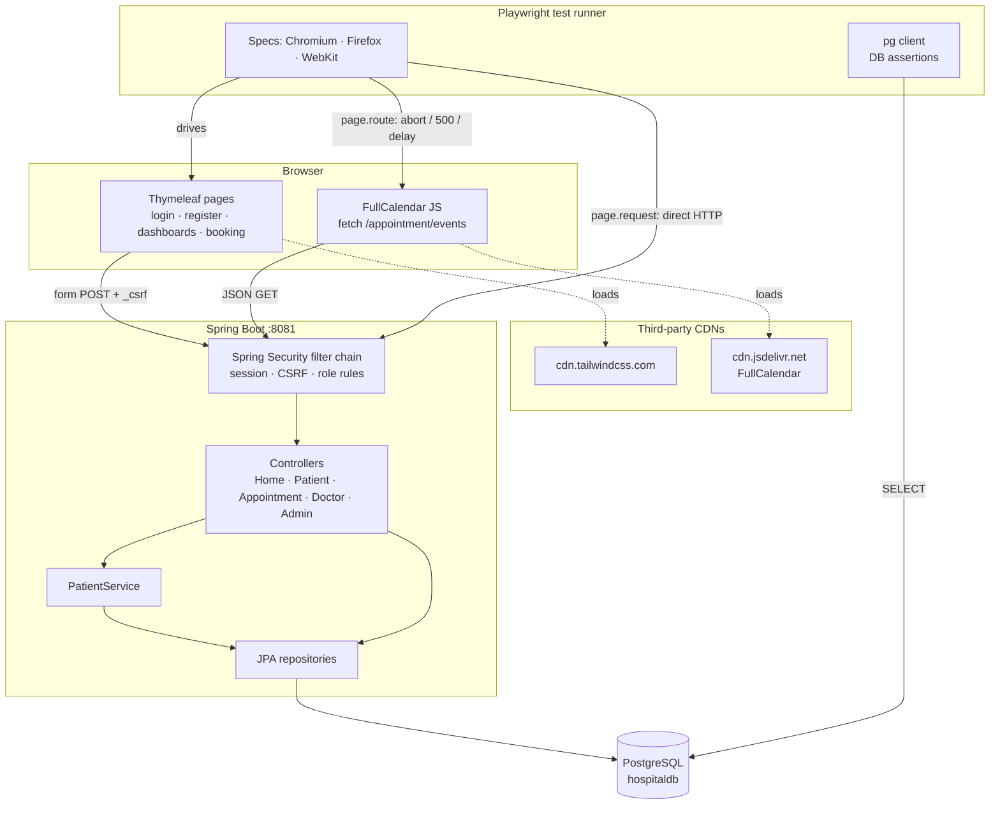

# CSE731 Software Testing: Final Project Report

**End-to-end testing of a Hospital Management System**

| Project | Details |
|---|---|
| Team | Dharani Prasad S (MT2025043), Abhishek Prasanna (MT2025007) |
| Repository | https://github.com/dharani070707/Software-Project |
| Test framework | Playwright 1.65.1 (TypeScript), Chromium / Firefox / WebKit |
| Test run | 27 Nov 2026, 61 test cases × 3 browsers = 183 executions |

---

## 1. Application under test

A Hospital Management System with three roles. **Patients** register, log in and book appointments. **Doctors** see their appointments. **Admins** manage users (change role, delete) and appointments (complete, delete).

| Layer | Technology |
|---|---|
| Web UI | Thymeleaf server-rendered HTML, Tailwind CSS (CDN), FullCalendar 6 (CDN) |
| Application server | Java 21, Spring Boot 3, Spring MVC, Spring Security (form login, sessions, CSRF) |
| Data access | Spring Data JPA / Hibernate |
| Database | PostgreSQL 16 (`users`, `patients`, `appointments`) |

### 1.1 Architecture



The tests touch the system in four ways:
1. **Through the browser**, as a user would.
2. **Through direct HTTP requests** that skip the browser (bypass testing).
3. **By intercepting the network** (failure simulation).
4. **By reading PostgreSQL directly**, to prove each action did, or did not, change the database.

---

## 2. Testing problems considered

| # | Problem | Why it matters here | Where tested |
|---|---|---|---|
| P1 | Registration and authentication | The entry point of every workflow, with three roles | `tests/auth` |
| P2 | Adding records (appointments) and checking the DB | The brief requires database updates, not just UI changes | `tests/appointments`, `tests/workflow` |
| P3 | Editing and deleting records (admin) | Role changes and deletes alter other users' access | `tests/admin`, `tests/workflow` |
| P4 | The critical multi-role workflow | One record, created by a patient, must reach the doctor and the admin | `tests/workflow` |
| P5 | Form validation done only in the browser | `required`, `min`, `minlength`, `type=email` and `<select>` can all be skipped by an attacker | `tests/negative/bypass`, `TC-AUTH-07` |
| P6 | Unauthorized access | Role rules, session lifetime, CSRF | `tests/negative/unauthorized` |
| P7 | Network failures | The calendar depends on an AJAX call and two CDNs | `tests/negative/network` |
| P8 | Browser compatibility | The same suite must behave the same on all three browser engines | all, via 3 Playwright projects |

### 2.1 Client-side testing techniques

**Bypass testing** (Offutt et al.) is used for form validation and input errors. The browser enforces rules, the server may not, and an attacker can skip the browser. We bypassed each client-side rule at three levels:

| Level | What we change | Example tests |
|---|---|---|
| Value | Send a value the HTML blocks | past date (`min`), empty `required` field, invalid email, too-short password, 25:99 time, a name longer than the DB column |
| Parameter | Tamper with a value the UI does not let you choose | rewrite a `<select>` option so `doctorId` = the admin's id; a non-existent id |
| Control flow | Skip the form and POST straight to the server | `page.request.post('/appointment/book', …)` with a missing field |

How it's done in Playwright: `form.noValidate = true` and `removeAttribute('min')` turn off the HTML5 checks, `page.evaluate()` rewrites DOM values, and `page.request.post()` sends raw requests with a valid CSRF token. **The verdict always comes from the database:** the input is "rejected" only if no row was written.

**Session-data-based testing** is used for unauthorized access. Spring keeps the login in a `JSESSIONID` cookie and guards forms with a `_csrf` token. We captured, replayed, forged and removed this session data:

| Session manipulation | Test |
|---|---|
| No session at all | TC-UNAUTH-01, 02 |
| Valid session, wrong role | TC-UNAUTH-03, 04, 05 |
| Valid session, replaying an admin-only request (with a real CSRF token) | TC-UNAUTH-06, 07 |
| Cookie copied before logout, replayed after (`storageState`) | TC-UNAUTH-08 |
| Tampered session id | TC-UNAUTH-09 |
| Session fixation (id must change at login) | TC-UNAUTH-10 |
| Valid session, CSRF token removed | TC-UNAUTH-11 |

**Network-failure simulation** uses `page.route()` to abort a request, answer it with HTTP 500, or delay it by 5 s, and `context.setOffline(true)` to drop the connection completely (TC-NET-01…06).

---

## 3. Choice of tools

| Need | Choice | Reason |
|---|---|---|
| Browser automation | **Playwright** | One API for Chromium, Firefox and WebKit, so browser compatibility comes built in. Auto-waiting reduces flaky tests. |
| Network failures | Playwright `page.route`, `setOffline` | Built in, so no proxy is needed. It can abort, fake or delay any request, including CDN files. |
| Session manipulation | Playwright `storageState`, `context.cookies()/addCookies()` | Save, replay and edit cookies per browser context. Separate contexts give truly separate users in one test. |
| Bypass / API calls | Playwright `page.request` | Shares the browser's cookies, so raw requests are sent as the logged-in user. This made Postman unnecessary. |
| Database assertions | `pg` (node-postgres) | Proves that DB changes really happened, independent of what the UI shows. |
| Reporting | Playwright HTML + JSON reporters, `summary.mjs` | HTML gives screenshots, video and a trace for each failure. JSON feeds the pass/fail tables below. |

Configuration (`e2e/playwright.config.ts`): `workers: 1` because the tests share one database; `retries: 0` so every failure is counted; screenshot, video and trace are kept for each failure.

### 3.1 Browser compatibility

| Project | Engine | Version | Pass | Fail |
|---|---|---|---|---|
| chromium | Chrome for Testing (Blink) | 159.0.8154.6 | 40 | 21 |
| firefox | Gecko | 159.0 | 40 | 21 |
| webkit | WebKit (Safari engine) | 27.2 | 39 | 22 |

The same 21 tests fail on all three engines. They are application bugs, not browser bugs. The one extra WebKit failure (TC-AUTH-05) was a **flaky timeout**: the login button wasn't ready within 30 s, most likely while the render-blocking Tailwind CDN script loaded. It passed 5 out of 5 times when re-run on WebKit (`--repeat-each=5`), so we classify it as flaky, not as a defect. **No browser-specific application defect was found.**

---

## 4. Test cases

**P** = pass, **F** = fail; browser order C/F/W = Chromium / Firefox / WebKit. Bug IDs refer to Section 5.

### 4.1 Authentication and registration (`tests/auth`)

| ID | Test case | Technique | Expected result | C/F/W | Bug |
|---|---|---|---|---|---|
| TC-AUTH-01 ×3 | Valid login as admin, doctor, patient | Positive | Lands on that role's dashboard | PPP | |
| TC-AUTH-02 | Wrong password | Negative | Stays on `/login?error` with an error | PPP | |
| TC-AUTH-03 | Unknown email | Negative | Same message as a wrong password (no user enumeration) | PPP | |
| TC-AUTH-04 | Logout, Back, then a protected URL | Session | Login page again | PPP | |
| TC-AUTH-05 | Register, then log in | Positive, DB | Account works | PP**F**¹ | |
| TC-AUTH-05b | Message after registration | Positive | "Registration successful" shown | FFF | BUG-01 |
| TC-AUTH-06 | Register a duplicate email | Negative | Stays on form, "Email already registered!" shown | FFF | BUG-02 |
| TC-AUTH-07 ×3 | Password 5 / 6 / 7 characters in the UI | Boundary value | 5 blocked by the browser; 6 and 7 accepted | PPP | |
| TC-AUTH-07 ×2 | Password `12345` / empty with browser checks off | Bypass (value) | Server rejects, no account | FFF | BUG-03 |

¹ Flaky on WebKit, see 3.1.

### 4.2 Appointments: adding records (`tests/appointments`)

| ID | Test case | Technique | Expected result | C/F/W | Bug |
|---|---|---|---|---|---|
| TC-APPT-01 | Patient books a valid appointment | Positive, DB | Row with SCHEDULED status, Dr Sarah, 30-min slot, correct title | PPP | |
| TC-APPT-02 | Appointment visible on the patient calendar | Positive | Event shown on today's date | FFF | BUG-04 |
| TC-APPT-03 | Confirmation after booking | Positive | "Appointment booked successfully!" | FFF | BUG-05 |
| TC-APPT-04 | Dashboard "Upcoming" counter | Positive | 0 → 1 | FFF | BUG-06 |
| TC-APPT-05 | Doctor sees today's patient | Positive, multi-role | Patient name under "Today's Patients" | PPP | |
| TC-APPT-06 | Admin sees the appointment | Positive, multi-role | Row with patient, Dr. Sarah Doctor, SCHEDULED | PPP | |
| TC-APPT-07 | Patient B's events feed | Privacy | Does not contain patient A's appointment | PPP | |

### 4.3 Critical workflows (`tests/workflow`)

| ID | Test case | Expected result | C/F/W |
|---|---|---|---|
| TC-FLOW-01 | Register (UI) → login → book → doctor sees → admin sees → admin deletes | DB checked at every step; row gone at the end | PPP |
| TC-FLOW-02 | Register → admin changes role to DOCTOR → user logs in → appears in the booking dropdown | DB role = DOCTOR; doctor dashboard; selectable | PPP |

### 4.4 Admin: editing and deleting records (`tests/admin`)

| ID | Test case | Expected result | C/F/W | Bug |
|---|---|---|---|---|
| TC-ADM-01 | Dashboard counters | Equal to SQL `count(*)` for users, patients, doctors, appointments | PPP | |
| TC-ADM-02 | Delete a patient with no appointments | Gone from the list, `users` and `patients` | PPP | |
| TC-ADM-03 | Delete a patient who has an appointment | Handled (deleted or refused with a message), no HTTP 500 | FFF | BUG-07 |
| TC-ADM-04 | "Complete" an appointment | Status becomes COMPLETED | FFF | BUG-08 |
| TC-ADM-05 | Role dropdown shows the current role | Selected value = role in DB | FFF | BUG-09 |

### 4.5 Bypass testing: form validation (`tests/negative/bypass.spec.ts`)

| ID | Test case | Level | Expected result | C/F/W | Bug |
|---|---|---|---|---|---|
| TC-BYP-01 | Book with a past date (`min` removed) | Value | No row written | FFF | BUG-10 |
| TC-BYP-02 | Book with `doctorId` = admin (option rewritten) | Parameter | No appointment with a non-doctor | FFF | BUG-11 |
| TC-BYP-03 | Book with `doctorId` = 999999 | Parameter | Handled error (< 500), no row | FFF | BUG-12 |
| TC-BYP-04 | Book with time `25:99` | Value | Handled error (< 500), no row | FFF | BUG-12 |
| TC-BYP-05 | Book with the `time` field missing | Control flow | HTTP 400, no row | PPP | |
| TC-BYP-06 | Two patients book the same doctor and slot | Business rule | Only one row | FFF | BUG-13 |
| TC-BYP-07 | Register with an empty name | Value | No account | FFF | BUG-14 |
| TC-BYP-08 | Register with `not-an-email` | Value | No account | FFF | BUG-14 |
| TC-BYP-09 | Register with a 300-character name | Value | Stays on the form with an error; no account | FFF | BUG-15 |
| TC-BYP-10 | Register with an `` name | Value (XSS) | Shown as text, script never runs | PPP | |

### 4.6 Unauthorized access: session-data-based (`tests/negative/unauthorized.spec.ts`)

| ID | Test case | Expected result | C/F/W |
|---|---|---|---|
| TC-UNAUTH-01 ×6 | Anonymous visit to 6 protected pages | Redirect to `/login` | PPP |
| TC-UNAUTH-02 | Anonymous call to the JSON API `/appointment/events` | 302 → `/login`, no data | PPP |
| TC-UNAUTH-03 | Patient → `/admin/users` | 403 | PPP |
| TC-UNAUTH-04 | Patient → `/doctor/dashboard` | 403 | PPP |
| TC-UNAUTH-05 | Doctor → `/admin/dashboard` | 403 | PPP |
| TC-UNAUTH-06 | Patient replays admin "delete user" with a valid CSRF token | 403, victim still in DB | PPP |
| TC-UNAUTH-07 | Patient changes their own role to ADMIN | 403, role still PATIENT | PPP |
| TC-UNAUTH-08 | Cookie saved before logout, reused after | Login page | PPP |
| TC-UNAUTH-09 | Tampered `JSESSIONID` | Login page | PPP |
| TC-UNAUTH-10 | Session id before vs. after login | Different (no fixation) | PPP |
| TC-UNAUTH-11 | Booking POST without `_csrf` | 403, no row | PPP |
| TC-UNAUTH-12 | Doctor tries to book | "Only registered patients can book appointments." | PPP |

### 4.7 Network failures (`tests/negative/network.spec.ts`)

| ID | Test case | Simulation | Expected result | C/F/W | Bug |
|---|---|---|---|---|---|
| TC-NET-01 | Calendar data request fails | `route.abort()` | Error message shown | FFF | BUG-16 |
| TC-NET-02 | Calendar data request returns 500 | `route.fulfill(500)` | Error message shown | FFF | BUG-16 |
| TC-NET-03 | FullCalendar CDN unreachable | abort `cdn.jsdelivr.net` | Message shown, no uncaught JS error | FFF | BUG-17 |
| TC-NET-04 | Connection drops while booking | `setOffline(true)` | Nothing saved; retry saves exactly one row | PPP | |
| TC-NET-05 | Calendar data takes 5 s | delayed `route.continue()` | Page heading visible within 2 s | PPP | |
| TC-NET-06 | Tailwind CDN unreachable | abort `cdn.tailwindcss.com` | Login still works | PPP | |

---

## 5. Bug reports

Each bug was reproduced on all three browsers. Screenshot, video and trace for every failure are in the HTML report (`npm run report`). Severity: **High** = data integrity or security; **Medium** = a feature broken or a crash; **Low** = cosmetic or feedback only.

| ID | Title | Severity | Found by |
|---|---|---|---|
| BUG-01 | Registration success message is never shown | Low | TC-AUTH-05b |
| BUG-02 | Duplicate-email error is never shown | Medium | TC-AUTH-06 |
| BUG-03 | Server accepts passwords shorter than 6 characters, even empty ones | High | TC-AUTH-07 |
| BUG-04 | Patient calendar never shows any appointment | High | TC-APPT-02 |
| BUG-05 | No confirmation after booking | Low | TC-APPT-03 |
| BUG-06 | Patient dashboard counters always show 0 | Medium | TC-APPT-04 |
| BUG-07 | Deleting a patient who has appointments crashes (HTTP 500) | High | TC-ADM-03 |
| BUG-08 | "Complete" appointment button does nothing (no endpoint) | Medium | TC-ADM-04 |
| BUG-09 | Role dropdown doesn't show the user's current role | Medium | TC-ADM-05 |
| BUG-10 | Appointments can be booked in the past | High | TC-BYP-01 |
| BUG-11 | Any user (e.g. the admin) can be booked as the doctor | High | TC-BYP-02 |
| BUG-12 | Invalid doctor id or time crashes the booking (HTTP 500) | Medium | TC-BYP-03, 04 |
| BUG-13 | A doctor can be double-booked for the same slot | High | TC-BYP-06 |
| BUG-14 | Server accepts an empty name and an invalid email | Medium | TC-BYP-07, 08 |
| BUG-15 | A name longer than 255 characters fails silently and looks like success | Medium | TC-BYP-09 |
| BUG-16 | Calendar shows nothing when its data request fails | Medium | TC-NET-01, 02 |
| BUG-17 | Calendar page crashes with a script error when the CDN is down | Low | TC-NET-03 |
| BUG-18 | `docker-compose up` starts an app that can't be reached | Low | Inspection (not executed) |

### BUG-01: Registration success message is never shown
- **Steps:** Open `/register` → fill a valid form → Register.
- **Expected:** The login page says "Registration successful! Please login."
- **Actual:** The login page shows no message.
- **Cause:** `PatientController.registerPatient` adds the flash attribute `msg`, but `login.html` only renders `param.error`. Nothing displays `msg`.

### BUG-02: Duplicate-email error is never shown
- **Steps:** Register an email, then register the same email again.
- **Expected:** "Email already registered!" on the form.
- **Actual:** The form reloads silently. The account is correctly not created, but the user isn't told why.
- **Cause:** The flash attribute `error` is set, but `register.html` has no element that renders it.

### BUG-03: Server accepts weak and empty passwords
- **Steps:** On `/register`, turn off browser validation (`form.noValidate = true`) and submit the password `12345` or an empty password.
- **Expected:** Rejected; the 6-character minimum applies on the server too.
- **Actual:** Accounts are created (confirmed in `users`) and the user is sent to the login page as if registration succeeded.
- **Cause:** The only check is `minlength="6"` in the HTML. `@RequestParam String password` is never validated.

### BUG-04: Patient calendar never shows any appointment
- **Steps:** As a patient, book an appointment for today → land on `/appointment/calendar`.
- **Expected:** The appointment appears on today's date.
- **Actual:** The calendar is empty, even though the row exists in `appointments`.
- **Cause:** `/appointment/events` returns JSON with the keys `start`/`end`, but `calendar.html` maps `a.startTime`/`a.endTime`, which are `undefined`, so FullCalendar drops every event.

### BUG-05: No confirmation after booking
- **Steps:** Book a valid appointment.
- **Expected:** "Appointment booked successfully!"
- **Actual:** No message.
- **Cause:** The flash message is rendered by `book.html`, but the controller redirects to `calendar.html`.

### BUG-06: Patient dashboard counters always show 0
- **Steps:** A fresh patient books one future appointment → opens `/patient/dashboard`.
- **Expected:** Upcoming = 1.
- **Actual:** Upcoming = 0 (and Completed is always 0).
- **Cause:** `patientDashboard()` never adds `upcomingCount`/`completedCount` to the model, and the template falls back to `0`.

### BUG-07: Deleting a patient who has appointments crashes
- **Steps:** A patient books an appointment → the admin deletes that patient on `/admin/users`.
- **Expected:** The patient and their appointments are deleted, or the admin is told why not.
- **Actual:** HTTP 500. The user, patient and appointment rows all remain in the database.
- **Cause:** `appointments.patient_id` has a foreign key to `patients`. Deleting the user cascades to `patients`, which still has appointment rows pointing at it.

### BUG-08: "Complete" appointment button does nothing
- **Steps:** Admin → `/admin/appointments` → click **Complete** on a SCHEDULED row.
- **Expected:** Status becomes COMPLETED.
- **Actual:** HTTP 404 error page; the status stays SCHEDULED.
- **Cause:** The template posts to `/admin/appointments/{id}/complete`, but `AdminController` has no such mapping.

### BUG-09: Role dropdown doesn't show the user's current role
- **Steps:** Admin → `/admin/users`.
- **Expected:** Each row's dropdown shows that user's role.
- **Actual:** Every row shows ADMIN. Because the dropdown submits on *change*, picking ADMIN for a patient does nothing, so a user can't be promoted to admin from this page.
- **Cause:** `th:selected="${user.role == 'ADMIN'}"` compares a Java enum to a String, which is always false, so the browser selects the first option.

### BUG-10: Appointments can be booked in the past
- **Steps:** On `/appointment/book`, remove the `min` attribute and turn off validation → date `2020-01-01` → Book.
- **Expected:** Rejected.
- **Actual:** A SCHEDULED appointment dated 1 Jan 2020 is saved.
- **Cause:** The date is only checked by `min="2025-01-01"` in HTML (itself already in the past). The server doesn't validate it.

### BUG-11: Any user can be booked as the doctor
- **Steps:** On `/appointment/book`, change an option's value to the admin's user id → Book.
- **Expected:** Rejected: the user isn't a doctor.
- **Actual:** An appointment is saved with `doctor_id` = the admin.
- **Cause:** `userRepo.findById(doctorId)` never checks `role == DOCTOR`.

### BUG-12: Invalid doctor id or time crashes the booking
- **Steps:** POST `/appointment/book` with `doctorId=999999`, or with `time=25:99`.
- **Expected:** A validation message (HTTP 4xx).
- **Actual:** HTTP 500 (`RuntimeException("Doctor not found")` / `DateTimeParseException`).
- **Cause:** No input validation or error handling in `AppointmentController.book`.

### BUG-13: Double booking
- **Steps:** Patients A and B each book Dr Sarah for the same date and time.
- **Expected:** The second booking is refused.
- **Actual:** Both are saved.
- **Cause:** There's no availability check and no unique constraint on (doctor, start_time).

### BUG-14: Server accepts an empty name and an invalid email
- **Steps:** On `/register`, turn off validation → empty name, or email `not-an-email`.
- **Expected:** Rejected.
- **Actual:** Accounts are created.
- **Cause:** The controller uses `@Valid`, but `Patient` has no `@NotBlank`/`@Email` annotations, so validation always passes.

### BUG-15: Over-long name fails silently and looks like success
- **Steps:** Register with a 300-character name.
- **Expected:** "Name too long" on the form.
- **Actual:** The user is sent to the login page as if registration had worked, but no account exists. The server log shows `value too long for type character varying(255)`.
- **Cause:** There's no length validation, so the insert fails. Spring forwards the 500 error to `/error`, which isn't in the `permitAll` list, so Spring Security redirects the anonymous user to `/login` and hides the crash.

### BUG-16: Calendar shows nothing when its data request fails
- **Steps:** Open `/appointment/calendar` while `/appointment/events` fails or returns 500.
- **Expected:** "Could not load appointments, try again."
- **Actual:** An empty calendar, indistinguishable from "no appointments".
- **Cause:** The `fetch(...).catch(err => failureCallback(err))` path shows nothing to the user.

### BUG-17: Calendar page crashes when the CDN is down
- **Steps:** Open the calendar with `cdn.jsdelivr.net` unreachable.
- **Expected:** A message saying the calendar can't load.
- **Actual:** An uncaught `ReferenceError: FullCalendar is not defined` and a blank area.
- **Cause:** The library is loaded only from a CDN, and the page has no fallback or check.

### BUG-18: Docker setup is unreachable *(found by inspection, not executed)*
- `docker-compose.yml` maps port `8080:8080`, but `application.properties` sets `server.port=${PORT:8081}` and compose never sets `PORT`. The container listens on 8081, so http://localhost:8080 doesn't answer.

---

## 6. Execution summary

Run of 27 Nov 2026: 61 test cases × 3 browsers = 183 executions, serial, 631 s. Generated with `npm run summary`.

| Browser | Passed | Failed | Pass rate |
|---|---|---|---|
| Chromium | 40 | 21 | 65.6% |
| Firefox | 40 | 21 | 65.6% |
| WebKit | 39 | 22 | 63.9% |
| **Total** | **119** | **64** | **65.0%** |

| Module | Passed | Failed | Pass rate |
|---|---|---|---|
| auth | 29 | 13 | 69.0% |
| appointments | 12 | 9 | 57.1% |
| workflow | 6 | 0 | 100.0% |
| admin | 6 | 9 | 40.0% |
| negative (bypass, unauthorized, network) | 66 | 33 | 66.7% |
| **Total** | **119** | **64** | **65.0%** |

**How to read these numbers.** A failing test here means the application did not behave as specified, so each failure maps to a bug in Section 5. 63 of the 64 failures map to 17 executed bugs; the remaining 1 is the flaky WebKit run. The low pass rates are mostly in input validation (bypass) and in admin features, while access control is strong: **all 16 unauthorized-access tests pass on every browser**. Spring Security's role rules, session handling and CSRF protection hold up, but the application code behind them does almost no server-side validation.

---

## 7. Repository and how to run

Repository: **https://github.com/dharani070707/Software-Project**

```
src/                    Spring Boot application
e2e/
  playwright.config.ts  3 browsers, 1 worker, HTML + JSON reporters
  helper/auth.ts        login(), seeded users, uniqueEmail()
  helper/app.ts         DB queries, CSRF, test-data setup, booking helper
  tests/auth/           TC-AUTH-*
  tests/appointments/   TC-APPT-*
  tests/workflow/       TC-FLOW-*
  tests/admin/          TC-ADM-*
  tests/negative/       TC-BYP-*, TC-UNAUTH-*, TC-NET-*
  summary.mjs           pass/fail tables from results.json
```

The install and run steps are in `README.MD` → "End-to-End Tests (Playwright)".

---

## 8. Tools and assistance

The project brief asks teams not to use AI agents for testing. Before using any, we checked with the instructor, who allowed AI help provided we can explain all of the work in the viva.

| Part of the work | Who did it |
|---|---|
| Choosing the application, the Playwright setup, and the first authentication and registration tests (TC-AUTH-01…07, including the first bypass test) | Team |
| Setting up the local environment (database, running the app, installing browsers) | Team, with help from Claude Code (Anthropic's AI coding assistant) |
| Remaining test code (appointments, workflows, admin, bypass, session and network tests), the DB helpers, and the first draft of this report | Written with Claude Code, then reviewed, run and checked by the team |
| Checking each failure: confirming it is a real application bug and not a mistake in the test, using screenshots, server logs and database queries | Team, with Claude Code |
| Final review of the test cases, bug reports and this report | Team |

The AI assistant was a development tool used while writing the test code. It is not part of the test suite. The tests themselves are plain Playwright scripts with no AI or agentic framework involved, and they run the same way on any machine.
